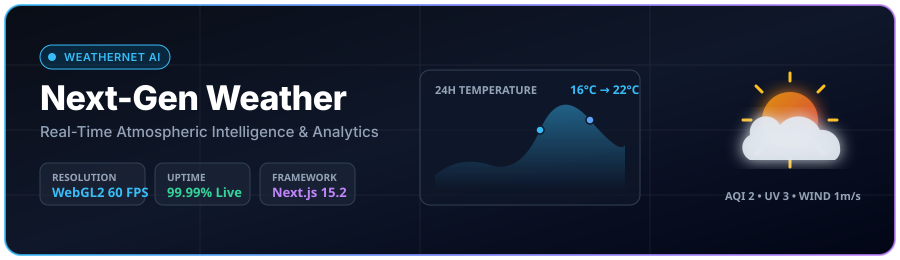
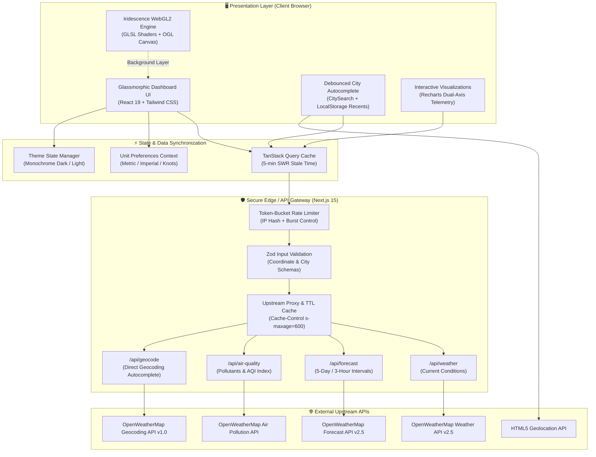
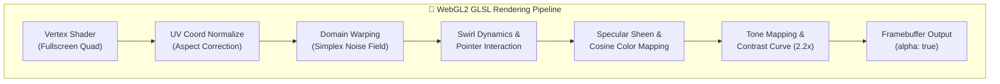
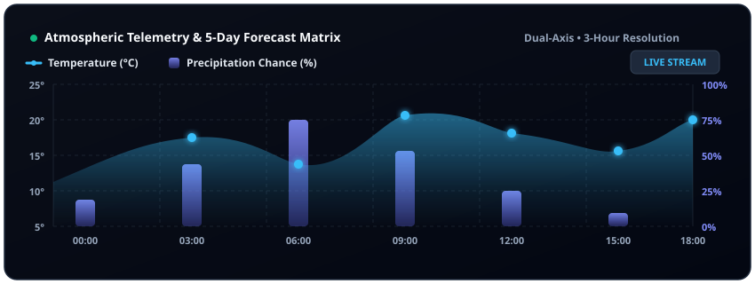
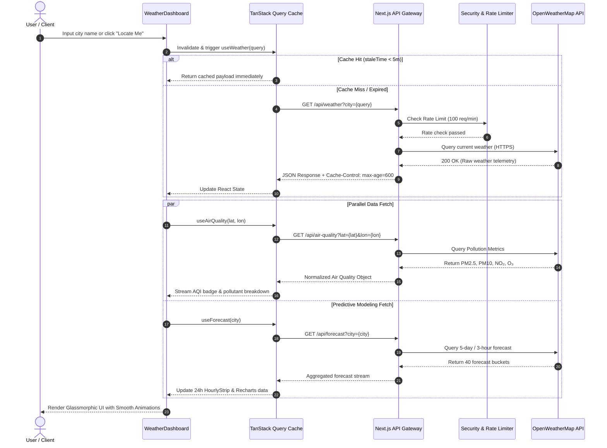
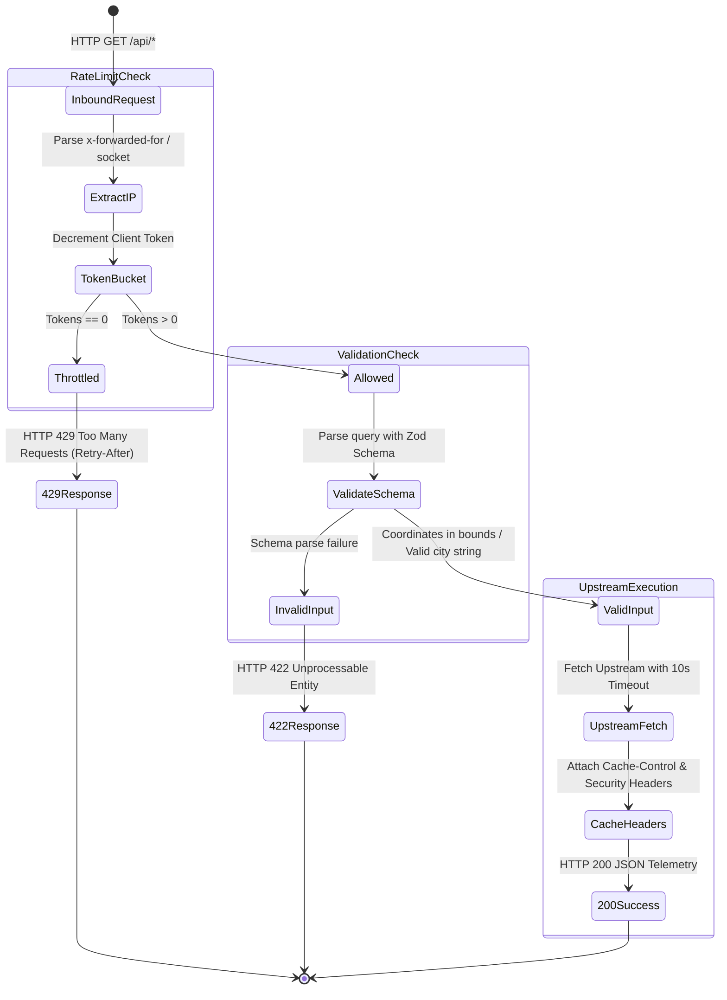

<div align="center">


# WeatherNet - Advanced Weather Network

### Enterprise-Grade Atmospheric Intelligence & Predictive Weather Analytics

[](https://nextjs.org/)
[](https://react.dev/)
[](https://www.typescriptlang.org/)
[](https://tailwindcss.com/)
[](https://www.khronos.org/webgl/)
[](https://tanstack.com/query)

<br />



</div>

---

## Table of Contents

- [Overview](#overview)
- [System Architecture](#system-architecture)
- [WebGL2 Shader Engine](#webgl2-shader-engine)
- [Interactive Forecast & Telemetry Charts](#interactive-forecast--telemetry-charts)
- [Component Hierarchy](#component-hierarchy)
- [Data Flow & Lifecycle](#data-flow--lifecycle)
- [API Hardening & Security Pipeline](#api-hardening--security-pipeline)
- [Core Features](#core-features)
- [Tech Stack](#tech-stack)
- [Installation & Setup](#installation--setup)
- [Available Scripts](#available-scripts)
- [License & Legal](#license--legal)

---

## Overview

**WeatherNet** is an advanced, high-performance meteorological dashboard application engineered with **Next.js 15 (App Router)**, **React 19**, **WebGL2 GLSL Shaders**, and **Tailwind CSS**. It delivers real-time weather analytics, multi-day predictive modeling, air quality monitoring, and interactive visualizations inside a responsive glassmorphic user interface powered by custom liquid-silver WebGL shaders.

---

## System Architecture



---

## WebGL2 Shader Engine

WeatherNet features a native **WebGL2 GLSL Fragment Shader** backdrop (`Iridescence`) that generates interactive fluid ripples and specular reflections without degrading UI framerates.



### Shader Specifications
- **Render Mode**: Non-blocking background worker (`pointer-events-none z-0`)
- **Resolution**: Native viewport scaling with DPI clamping (`Math.min(devicePixelRatio, 2)`)
- **Color Model**: High-contrast liquid silver (`saturation: 0`, `contrast: 2.2`, `brightness: 0.55`)
- **Performance**: 60 FPS capped with `requestAnimationFrame` and `visibilitychange` dormancy

---

## Interactive Forecast & Telemetry Charts

<div align="center">
  
</div>

WeatherNet provides high-density meteorological analytics with dual-axis synchronization:

| Metric | Resolution | Visual Display | Measurement Unit |
| :--- | :--- | :--- | :--- |
| **Temperature** | 3-Hour Intervals | Monotone Gradient Area Curve | Celsius (°C) / Fahrenheit (°F) |
| **Precipitation** | 3-Hour Cumulative | Rounded Probability Bars | Percentage (0% – 100%) |
| **Atmospheric Pressure**| Real-Time & 5-Day | Precision Stepped Line | hPa / inHg / mmHg / psi |
| **Humidity Index** | Real-Time & 5-Day | Dual-Data Point Connected Line | Relative Humidity (%) |
| **Wind Vectors** | Directional Deg (0-360°) | Dynamic Compass Rose & Velocity | m/s, km/h, mph, knots |

---

## Component Hierarchy

```mermaid
graph TD
    RootLayout["RootLayout (app/layout.tsx)"]
    
    RootLayout --> Providers["Core Providers"]
    Providers --> ThemeProv["ThemeProvider"]
    Providers --> QueryProv["QueryProvider (TanStack)"]
    Providers --> UnitProv["UnitPreferencesProvider"]
    
    RootLayout --> Page["HomePage (app/page.tsx)"]
    
    Page --> WebGL["IridescenceBackground (WebGL2 Canvas)"]
    Page --> Header["Navigation & Branding Header"]
    Header --> Logo["Logo (/logo.png)"]
    Header --> ThemeToggle["ThemeToggle"]
    
    Page --> Dashboard["WeatherDashboard"]
    
    Dashboard --> SearchPanel["SearchPanel"]
    SearchPanel --> CitySearch["CitySearch (Autocomplete + Recents)"]
    SearchPanel --> UnitToggle["UnitToggle (°C/°F, Wind Units)"]
    
    Dashboard --> MainGrid["Primary Metric Grid"]
    MainGrid --> WeatherCard["Current Weather Card"]
    WeatherCard --> MetricTiles["Metric Tiles (Wind, Humidity, Vis, Press)"]
    MainGrid --> AirQualityCard["AirQualityCard (PM2.5, PM10, O₃, NO₂)"]
    MainGrid --> WeatherAlerts["WeatherAlerts (Dynamic Advisory System)"]
    
    Dashboard --> TabsNavigation["Analytics Tabs Navigation"]
    TabsNavigation --> TabCurrent["Tab: Current"]
    TabCurrent --> WeatherDetails["WeatherDetails (Sunrise, Sunset, Cloudiness)"]
    TabCurrent --> WeatherMap["WeatherMap (Interactive Coordinates & Geo View)"]
    
    TabsNavigation --> TabForecast["Tab: Forecast"]
    TabForecast --> HourlyStrip["HourlyStrip (24-Hour Predictive Strip)"]
    TabForecast --> ForecastGrid["ForecastGrid (5-Day Extended Cards)"]
    
    TabsNavigation --> TabCharts["Tab: Charts"]
    TabCharts --> WeatherChart["WeatherChart (Dual-Axis Recharts Engine)"]
    WeatherChart --> FallbackTable["Accessible Fallback Data Table"]
    
    TabsNavigation --> TabFavorites["Tab: Favorites"]
    TabFavorites --> FavoritesPanel["FavoritesPanel (Local Storage Collections)"]
```



---

## Data Flow & Lifecycle



---

## API Hardening & Security Pipeline

All external network operations are mediated through a defensive server-side abstraction layer located in [`lib/api-hardening.ts`](./lib/api-hardening.ts):



---

## Core Features

- **Real-Time Weather Intelligence**: Instant temperature, atmospheric pressure, relative humidity, cloudiness index, and wind velocity vectors.
- **24-Hour & 5-Day Forecasting**: High-resolution hourly forecast strip alongside 5-day predictive cards.
- **Air Quality Telemetry (AQI)**: Continuous monitoring of particulate matter (PM2.5, PM10), tropospheric ozone (O₃), and nitrogen dioxide (NO₂).
- **Interactive Multi-Chart Suite**: Recharts-powered temperature curves, precipitation likelihood bars, and barometric trends.
- **Geolocation & Intelligent Geocoding**: Browser-based position detection with debounced city search autocomplete and persistent recent searches.
- **Unit Preference Engine**: Dynamic metric/imperial/nautical unit switching (°C/°F, m/s, km/h, mph, knots).
- **Favorites Management**: LocalStorage-persisted bookmarks for instant multi-city tracking.
- **Progressive Web App (PWA)**: Offline service-worker registration, Web App Manifest, and cached static telemetry.

---

## Tech Stack

| Category | Technology | Purpose |
| :--- | :--- | :--- |
| **Framework** | **Next.js 15.2.8** | React Fullstack App Router, Edge Middleware, Static Site Generation |
| **Runtime** | **React 19.1.0** | Modern concurrent rendering, server components, and optimized hooks |
| **Language** | **TypeScript 5.8** | Full static type safety with strict compiler configuration |
| **Styling** | **Tailwind CSS 3.4** | Utility-first styling with custom frosted glassmorphic primitives |
| **Graphics** | **WebGL2 / OGL** | Native hardware-accelerated GLSL shader fluid background |
| **Data Fetching** | **TanStack Query 5.101** | Intelligent caching, stale-while-revalidate, and query deduplication |
| **Charts** | **Recharts 3.5.1** | Composed dual-axis area, line, and bar visualization primitives |
| **Validation** | **Zod 3.24** | Runtime request input parsing and environment variable guards |
| **Icons** | **Lucide React** | Consistent, accessible icon components |
| **Testing** | **Vitest 4.1 + RTL** | High-speed unit testing and coverage reporting |

---

## Installation & Setup

> **Note:** This repository is proprietary software developed by Ayush Singh.

### Prerequisites
- **Node.js**: v18.18 or higher (v20+ recommended)
- **Package Manager**: `pnpm` (v9 or v10)
- **API Key**: Free OpenWeatherMap API key ([openweathermap.org](https://openweathermap.org/api))

### Step-by-Step Setup

1. **Clone the repository:**
   ```bash
   git clone https://github.com/AyushSingh360/WeatherNet-AI.git
   cd WeatherNet-AI
   ```

2. **Install dependencies:**
   ```bash
   pnpm install
   ```

3. **Configure Environment Variables:**
   Create a `.env.local` file in the project root:
   ```env
   OPENWEATHERMAP_API_KEY=your_openweathermap_api_key_here
   NEXT_PUBLIC_SITE_URL=http://localhost:3000
   ```

4. **Launch Development Server:**
   ```bash
   pnpm dev
   ```
   Open [http://localhost:3000](http://localhost:3000) in your browser.

---

## Available Scripts

```bash
# Start Next.js development server
pnpm dev

# Perform TypeScript type checking
pnpm typecheck

# Run ESLint validation
pnpm lint

# Execute Vitest test suite
pnpm test

# Run tests with test coverage reporting
pnpm test:coverage

# Build optimized production bundle
pnpm build

# Start production server
pnpm start
```

---

## License & Legal

**© 2025 Ayush Singh. All rights reserved.**

This is proprietary software owned exclusively by **Ayush Singh**. No part of this software may be used, copied, modified, distributed, or otherwise utilized without explicit written permission from the copyright holder.

For commercial licensing and permissions:
- **Lead Developer**: Ayush Singh
- **GitHub**: [@AyushSingh360](https://github.com/AyushSingh360)
- **Inquiries**: [ayushsingh21109@gmail.com](mailto:ayushsingh21109@gmail.com)

---

<div align="center">
  <sub>Engineered with precision by <strong>Ayush Singh</strong> • WeatherNet AI</sub>
</div>